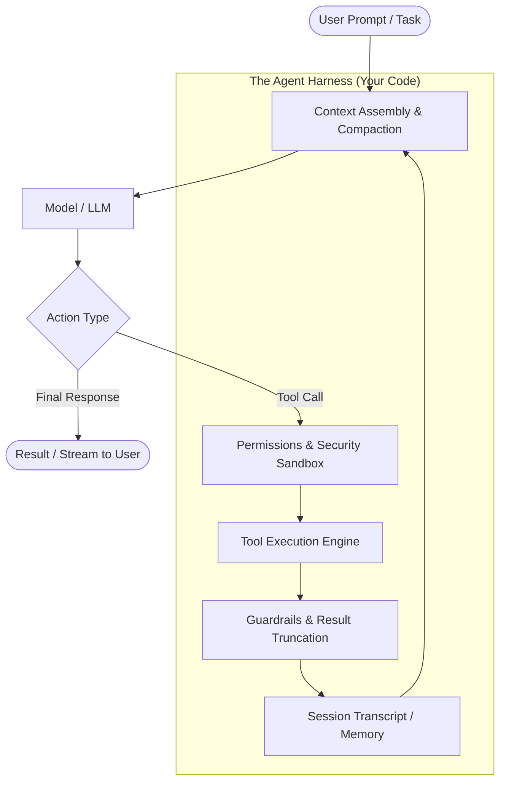

# AI Agent Harness Course

<div align="center">

[](LICENSE)
[](LICENSE-CONTENT)
[](https://astro.build)
[](https://react.dev)
[](https://pyodide.org)
[](#what-needs-internet)
[](https://ai-agent-harness-course.vercel.app)

**Learn AI agents by building them from first principles.**

A completely free, local-first, hands-on curriculum on autonomous AI agents and agent harnesses: **54 lessons** across 8 sections, **46 in-browser visual Agent Labs**, **8 in-browser Python Code Labs** (via Pyodide), and **3 end-to-end Python Capstone Projects**.

[Explore the Live Showcase](https://ai-agent-harness-course.vercel.app) · [Curriculum Overview](#curriculum) · [Quick Start](#quick-start) · [Capstone Projects](#capstone-projects)

</div>

---

## What is an Agent Harness?

> *"Same model, different harness — completely different agent."*

Raw Large Language Models (LLMs) only predict the next token. They cannot reliably manage long-running tasks, read files, execute bash scripts, persist sessions, recover from tool failures, or keep costs under control.

The **Agent Harness** is the software system engineered *around* the model to make it an autonomous agent:



The harness is responsible for:
- **The Execution Loop**: Driving the ReAct loop, parsing tool calls, and detecting termination criteria.
- **Context Management**: Token budgeting, sliding windows, and auto-compaction before context windows exhaust.
- **Tool Runtimes & Sandboxing**: Safe bash execution, filesystem isolation, timeout handling, and error recovery.
- **Permissions & Human-in-the-Loop**: Defining policy boundaries (allow / ask / deny) for critical side-effects.
- **State & Memory**: JSONL session persistence, transcript recovery across restarts, and semantic retrieval (RAG).
- **Multi-Agent Orchestration**: Coordinating worker subagents, handling handoffs, and evaluating outcomes.

---

## Key Highlights

- **Problem → Insight → Fix → Math → Tradeoff**: Every lesson follows a battle-tested structure inspired by [freesystemdesign.com](https://freesystemdesign.com/). No filler, no hand-waving — every concept ends on concrete metrics (cost, latency, tokens, reliability) and architectural tradeoffs.
- **Interactive Visual Agent Lab (46 Scenarios)**: Drag-and-drop agent building blocks (models, tools, memory, routers, guardrails, evaluators) using React Flow. Run deterministic simulations to see where architectures fail (infinite loops, prompt injections, context overflows, or budget blowups).
- **In-Browser Python Code Labs (8 Labs)**: Execute real Python code client-side via Pyodide without installing Python or compilers. Includes a deterministic mock model so you can learn offline for free, with an optional switch to test against your own Anthropic Claude API key.
- **3 Production-Grade Python Capstones**:
  1. `nanoharness`: Build an ~800-line coding agent CLI from scratch (tools, sandboxed bash, JSONL session resume, token compaction, subagents, and test evals).
  2. `supportbot`: Build a customer support agent with RAG over Markdown docs, SQLite state, tool routing, guardrails, prompt injection defenses, and escalation.
  3. `deepresearch`: Build a multi-agent research assistant with orchestrator-workers, parallel search, and citation verifiers.
- **100% Local-First & Privacy-Focused**: Zero accounts, zero tracking, no backend database. Your progress, custom graphs, and code lab solutions persist in browser `localStorage` and can be exported as a backup JSON file anytime.

---

## Curriculum

The course is organized into 8 comprehensive core sections, followed by the capstones:

### 1. Foundations (7 Lessons)
*How language models behave before they become agents.*
- **LLM**: What an LLM actually does (next-token prediction & temperature variance)
- **Tokens**: Tokenization and context window boundaries
- **Prompting**: Roles, system prompts, instructions, and order sensitivity
- **Structured**: Structured outputs and deterministic JSON schemas
- **Cost**: Cost and latency economics (pricing math per task)
- **Chat vs Agent**: Chatbots vs deterministic workflows vs autonomous agents
- **When Not**: Identifying problems where an agent is the wrong tool

### 2. Tool Use (7 Lessons)
*Giving the model hands to interact with the world.*
- **Tools**: Function calling mechanics and tool definition
- **Agent Loop**: The fundamental cycle (Call → Execute → Append → Repeat)
- **ReAct**: Reason-then-Act pattern and chain-of-thought tool selection
- **Tool Design**: Engineering tool signatures, parameter descriptions, and docstrings
- **Tool Errors**: Actionable error reporting and model self-correction
- **Parallel Tools**: Concurrent tool execution to minimize latency
- **MCP**: Model Context Protocol — standardized tool and resource interoperability

### 3. The Harness (9 Lessons)
*The software architecture running the model.*
- **Harness**: Anatomy of modern agent harnesses (Claude Code, Cursor, OpenHands)
- **Prompt Assembly**: Dynamic context construction (system instructions, memory, history)
- **Context Management**: Context compaction, sliding windows, and auto-summarization
- **Stop Conditions**: Budget guardrails, maximum turns, and loop prevention
- **Permissions**: Sandboxing, allow/ask/deny execution rules, and security controls
- **Hooks**: Lifecycle hooks (`pre_tool`, `post_tool`, formatting, validation)
- **Sessions**: Session transcripts, crash recovery, and `--resume`
- **Streaming**: Token streaming and real-time interactive UI updates
- **Subagents**: Spawning child contexts for isolated subtasks

### 4. Memory and Retrieval (6 Lessons)
*Short-term context, persistent state, and knowledge search.*
- **Memory Types**: Working, episodic, semantic, and procedural memory
- **Embeddings**: Vector spaces, cosine similarity, and text representations
- **RAG**: Retrieval-Augmented Generation with source citations
- **Chunking**: Chunk sizing strategies, overlapping, and document indexing
- **Agentic Search**: Active grep/filesystem exploration vs vector RAG
- **Memory Write**: Guarded memory persistence and poisoning prevention

### 5. Patterns and Multi-Agent (7 Lessons)
*Architectural patterns for scalable agent systems.*
- **Chaining**: Sequential prompt chains with deterministic quality gates
- **Routing**: Semantic intent classification and specialist dispatch
- **Parallelization**: Parallel generation, majority voting, and ensemble reviews
- **Orchestrator**: Orchestrator-worker patterns for complex task decomposition
- **Evaluator-Optimizer**: Generator-critic refinement loops
- **Planning**: Explicit step planning, tracking, and dynamic replanning
- **Handoffs**: Clean state transfer and transcript pruning between agents

### 6. Reliability and Safety (7 Lessons)
*Production resilience and defensive engineering.*
- **Guardrails**: Input validation and output redaction (e.g., PII protection)
- **Prompt Injection**: Direct and indirect injection attack defenses and trust boundaries
- **HITL**: Human-in-the-loop approval workflows for destructive actions
- **Idempotency**: Retries, idempotent tool execution, and state deduplication
- **Timeouts & Fallbacks**: Model timeouts, provider failovers, and graceful degradation
- **Determinism**: Mitigating non-determinism and stabilizing CI test runs
- **Computer Use**: Browser automation, OS interactions, and confirmation barriers

### 7. Evals and Operating Agents (6 Lessons)
*Observability, measurement, and deployment.*
- **Evals**: Designing test suites, benchmarks, and regression suites
- **LLM-as-Judge**: Automated grading frameworks and judge calibration
- **Trajectory Evals**: Evaluating intermediate tool-use paths, not just end answers
- **Tracing**: Full execution timelines, spans, and step debugging
- **Caching**: Prompt caching patterns to cut latency and API spend
- **Deploy**: Production architectures (APIs, queues, worker pools, secret storage)

### 8. Case Studies & Design Method (5 Lessons)
*Real-world agent system architecture.*
- **The 6-Step Agent Design Method**: Scope → Math → Tools → Loop & Context → Evals → Tradeoffs
- **Case Study: Coding Agent**: Architecture teardown of systems like Claude Code
- **Case Study: Support Agent**: Architecture teardown of enterprise support agents (like Intercom Fin)
- **Case Study: Deep Research**: Multi-agent research engines with citation validation
- **Case Study: Browser Agent**: Computer-use systems with safe confirmation mechanisms

---

## Capstone Projects

In addition to the interactive browser labs, the course includes 3 complete Python projects located in the [`projects/`](projects/) directory. Each project has step-by-step guidance, starter templates, unit test suites, and reference solutions:

```
projects/
├── nanoharness/        # Capstone 1: Autonomous Coding Agent Harness
│   ├── starter/        # Your implementation target
│   ├── solution/       # Reference implementation
│   ├── tests/          # Pytest verification suite
│   └── evals/          # 15 bug-fixing benchmark tasks
├── supportbot/         # Capstone 2: RAG Customer Support Agent
│   ├── starter/
│   ├── solution/
│   ├── data/           # 60 Markdown knowledge base articles
│   └── tests/
└── deepresearch/       # Capstone 3: Multi-Agent Deep Research System
    ├── starter/
    ├── solution/
    ├── data/           # Bundled offline search corpus
    └── tests/
```

### Running the Capstones Locally

Each capstone can be tested independently with `pytest`:

```bash
# 1. Test your starter implementation
cd projects/nanoharness
python3 -m pip install pytest
python3 -m pytest -q

# 2. Verify against the reference solution
IMPL=solution python3 -m pytest -q
```

---

## Quick Start

### Prerequisites
- **Node.js**: v22.0.0 or higher
- **Git**
- **Python**: v3.12+ *(optional, only needed for running the capstone project test suites locally)*

### Local Setup

Clone the repository and start the development server:

```bash
git clone https://github.com/sakshamm21/ai-agent-harness-course.git
cd ai-agent-harness-course
npm install
npm start
```

Open [http://localhost:4321](http://localhost:4321) in your browser.

- `npm start`: Builds the production bundle, generates the static search index (Pagefind), and launches the preview server.
- `npm run dev`: Starts the Astro development server with instant Hot Module Replacement (HMR) for editing lesson content.

### What Needs Internet?

Only the initial `npm install` requires an internet connection:
- **Pyodide** is vendored locally into `public/pyodide/` during installation, allowing Python code labs to execute completely offline.
- **Web fonts** (Inter, Space Grotesk, JetBrains Mono) are bundled locally via `@fontsource`.
- **Search** runs 100% client-side via Pagefind.
- **Simulations** in the Agent Lab run deterministically in pure TypeScript with no API calls.
- *(Optional)*: You can toggle the "Real Model" switch in code labs to test against Anthropic's Claude API using your own API key. Keys are stored strictly in `sessionStorage` and never touch any server.

---

## Repository Structure

```
.
├── src/
│   ├── content/
│   │   ├── lessons/          # 54 MDX lesson files
│   │   ├── scenarios/        # 46 Agent Lab simulation scenarios (JSON)
│   │   ├── codelabs/         # 8 in-browser Python Code Labs
│   │   └── projects/         # Capstone documentation pages
│   ├── lab/                  # Deterministic Agent Lab simulation engine (Pure TS)
│   ├── components/
│   │   ├── lab/              # Agent Lab visual workspace (React + React Flow)
│   │   └── codelab/          # Pyodide browser editor & test runner
│   └── styles/               # Global styling & dark mode typography
├── projects/                 # 3 standalone Python capstone projects
├── python/                   # agentkit_mini: lightweight agent toolkit for code labs
├── scripts/                  # Content validators, link checkers & Pyodide installers
├── tests/                    # Offline E2E and persistence verification test suites
└── docs/                     # Course architecture & authoring specifications
```

---

## Quality & Test Suite

All lessons, simulation scenarios, and code labs are covered by automated tests:

```bash
# Validate lesson structure, frontmatter schemas, and MDX formatting
node scripts/validate-content.mjs

# Run Agent Lab simulation engine unit tests (100 tests)
npm test

# Verify all in-browser Python code lab starters and solutions
python3 scripts/check_codelabs.py

# Verify Python agentkit_mini library
PYTHONPATH=python python3 -m pytest python/tests

# Run full static build and internal link validation
npm run build && npm run check
```

---

## Deployment

The course is configured to deploy effortlessly on **Vercel** or **Cloudflare Pages**:

- **Vercel**: Import the repository at [vercel.com/new](https://vercel.com/new). Zero configuration required (`vercel.json` and `package.json` handle everything automatically). Every push to `main` redeploys the production showcase at [ai-agent-harness-course.vercel.app](https://ai-agent-harness-course.vercel.app).
- See [DEPLOY.md](DEPLOY.md) for full deployment details and custom domain configuration.

---

## License

- **Course & Lesson Content**: [Creative Commons Attribution-NonCommercial-ShareAlike 4.0 International (CC BY-NC-SA 4.0)](LICENSE-CONTENT)
- **Source Code & Capstones**: [MIT License](LICENSE)

Created by **[Saksham Malhotra](https://github.com/sakshamm21)**. Inspired by the educational philosophy of [freesystemdesign.com](https://freesystemdesign.com/).
